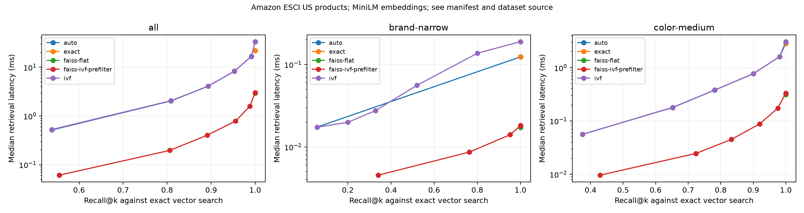

# Retrieval experiment

Dataset: Amazon ESCI US products; MiniLM embeddings; see manifest and dataset source

One query at a time. Timings exclude embeddings and transport. Recall is agreement with exact vector neighbors, not human relevance.

| Workload | Method | Probes | Recall@k | p50 ms | p95 ms |
|---|---|---:|---:|---:|---:|
| all | auto | 1 | 0.538 | 0.5159 | 0.8859 |
| all | auto | 4 | 0.809 | 2.0398 | 3.0162 |
| all | auto | 8 | 0.893 | 4.0908 | 5.4222 |
| all | auto | 16 | 0.953 | 8.3309 | 9.8772 |
| all | auto | 32 | 0.992 | 16.7339 | 19.0790 |
| all | auto | 64 | 1.000 | 33.4906 | 35.8641 |
| all | exact | 1 | 1.000 | 22.1125 | 23.3583 |
| all | faiss-flat | 1 | 1.000 | 2.9204 | 3.3043 |
| all | faiss-ivf-prefilter | 1 | 0.555 | 0.0610 | 0.0993 |
| all | faiss-ivf-prefilter | 4 | 0.806 | 0.1968 | 0.3242 |
| all | faiss-ivf-prefilter | 8 | 0.891 | 0.4045 | 0.5427 |
| all | faiss-ivf-prefilter | 16 | 0.956 | 0.7866 | 0.9605 |
| all | faiss-ivf-prefilter | 32 | 0.988 | 1.5849 | 1.8075 |
| all | faiss-ivf-prefilter | 64 | 1.000 | 3.0070 | 3.3474 |
| all | ivf | 1 | 0.538 | 0.5284 | 0.9012 |
| all | ivf | 4 | 0.809 | 2.0590 | 2.9175 |
| all | ivf | 8 | 0.893 | 4.1122 | 5.3333 |
| all | ivf | 16 | 0.953 | 8.3159 | 9.9312 |
| all | ivf | 32 | 0.992 | 16.7601 | 18.9155 |
| all | ivf | 64 | 1.000 | 33.5554 | 35.8356 |
| brand-narrow | auto | 1 | 0.058 | 0.0174 | 0.0259 |
| brand-narrow | auto | 4 | 1.000 | 0.1239 | 0.1377 |
| brand-narrow | auto | 8 | 1.000 | 0.1239 | 0.1386 |
| brand-narrow | auto | 16 | 1.000 | 0.1238 | 0.1399 |
| brand-narrow | auto | 32 | 1.000 | 0.1238 | 0.1376 |
| brand-narrow | auto | 64 | 1.000 | 0.1237 | 0.1389 |
| brand-narrow | exact | 1 | 1.000 | 0.1237 | 0.1411 |
| brand-narrow | faiss-flat | 1 | 1.000 | 0.0172 | 0.0176 |
| brand-narrow | faiss-ivf-prefilter | 1 | 0.341 | 0.0045 | 0.0060 |
| brand-narrow | faiss-ivf-prefilter | 4 | 0.763 | 0.0087 | 0.0105 |
| brand-narrow | faiss-ivf-prefilter | 8 | 0.952 | 0.0141 | 0.0157 |
| brand-narrow | faiss-ivf-prefilter | 16 | 1.000 | 0.0182 | 0.0187 |
| brand-narrow | faiss-ivf-prefilter | 32 | 1.000 | 0.0181 | 0.0185 |
| brand-narrow | faiss-ivf-prefilter | 64 | 1.000 | 0.0181 | 0.0184 |
| brand-narrow | ivf | 1 | 0.058 | 0.0173 | 0.0268 |
| brand-narrow | ivf | 4 | 0.200 | 0.0199 | 0.0863 |
| brand-narrow | ivf | 8 | 0.328 | 0.0275 | 0.1283 |
| brand-narrow | ivf | 16 | 0.520 | 0.0560 | 0.1577 |
| brand-narrow | ivf | 32 | 0.800 | 0.1372 | 0.1764 |
| brand-narrow | ivf | 64 | 1.000 | 0.1896 | 0.2107 |
| color-medium | auto | 1 | 0.375 | 0.0562 | 0.1451 |
| color-medium | auto | 4 | 0.652 | 0.1786 | 0.4188 |
| color-medium | auto | 8 | 0.781 | 0.3800 | 0.7809 |
| color-medium | auto | 16 | 0.900 | 0.7715 | 1.2032 |
| color-medium | auto | 32 | 0.981 | 1.6043 | 2.1038 |
| color-medium | auto | 64 | 1.000 | 2.8435 | 3.5462 |
| color-medium | exact | 1 | 1.000 | 2.8328 | 3.5847 |
| color-medium | faiss-flat | 1 | 1.000 | 0.3107 | 0.3327 |
| color-medium | faiss-ivf-prefilter | 1 | 0.429 | 0.0096 | 0.0161 |
| color-medium | faiss-ivf-prefilter | 4 | 0.724 | 0.0246 | 0.0369 |
| color-medium | faiss-ivf-prefilter | 8 | 0.833 | 0.0451 | 0.0656 |
| color-medium | faiss-ivf-prefilter | 16 | 0.920 | 0.0884 | 0.1090 |
| color-medium | faiss-ivf-prefilter | 32 | 0.975 | 0.1733 | 0.1932 |
| color-medium | faiss-ivf-prefilter | 64 | 1.000 | 0.3327 | 0.3528 |
| color-medium | ivf | 1 | 0.375 | 0.0559 | 0.1401 |
| color-medium | ivf | 4 | 0.652 | 0.1803 | 0.4183 |
| color-medium | ivf | 8 | 0.781 | 0.3787 | 0.7773 |
| color-medium | ivf | 16 | 0.900 | 0.7677 | 1.1823 |
| color-medium | ivf | 32 | 0.981 | 1.6067 | 2.0165 |
| color-medium | ivf | 64 | 1.000 | 3.0769 | 3.8192 |

Full environment, hashes, configuration, and individual observations are in report.json and raw.csv.gz.
Vector byte counts exclude metadata, cluster storage, allocator overhead, and process runtime. These results do not establish deployed service throughput.

Search-kernel reference: separately trained per-filter indexes; timings exclude filter selection/copying, unlike C++ timings. Not an end-to-end performance comparison. No claim of beating FAISS.

Protocol, interpretation, exact eligible counts, calibration, and reproduction commands: [real-data experiments](../../docs/REAL_DATA_RESULTS.md). The fixed calibration operating point is 32 probes; lower-probe rows do not inherit its recall target.

